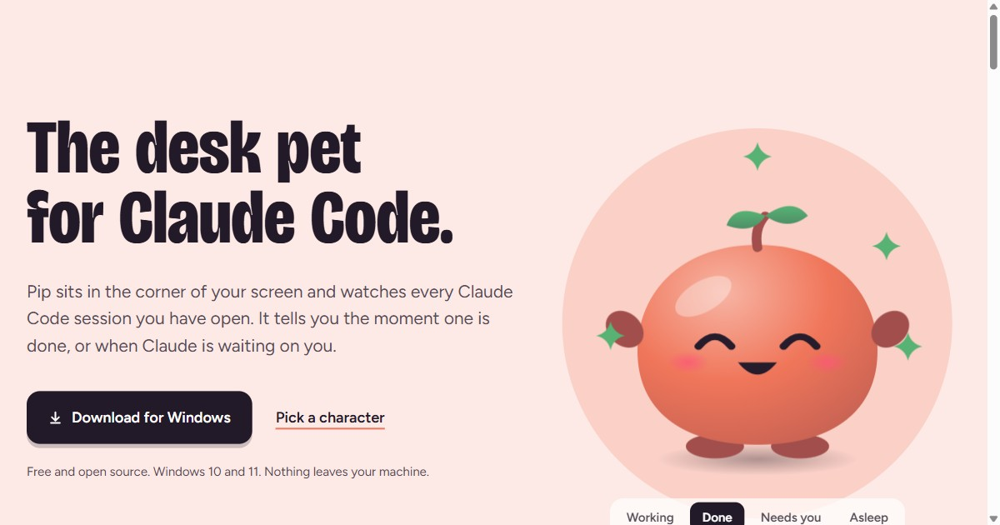
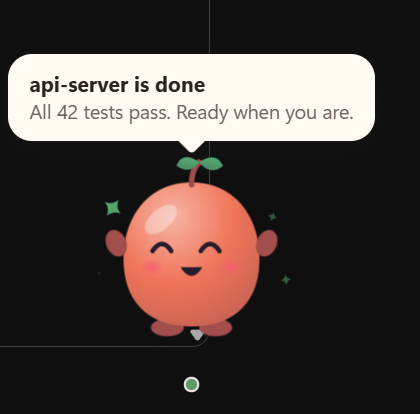
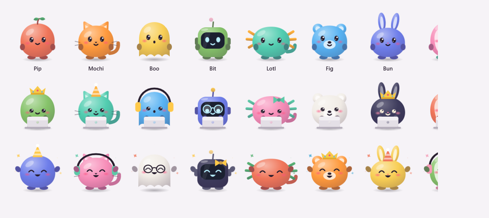

# Pip, the desk pet for Claude Code



Pip is a small animated pet that sits in the corner of your screen and watches every
[Claude Code](https://claude.com/claude-code) session you have open. It tells you the moment
a session is done, or when Claude is waiting on you.

**[Website](https://pip-pet.vercel.app)** · **[Download for Windows](https://github.com/youssef-110/pip-pet/releases/latest/download/Pip-Setup.exe)**



## What it does

- **Working**: while Claude thinks or runs tools, Pip types on a tiny laptop.
- **Done**: Pip hops, chimes, and shows the project name and the last line Claude wrote.
- **Needs you**: on a permission prompt or a question, Pip waves until you come back.
- **All sessions**: one dot per running session. Hover to see what each one is doing.
- **Out of the way**: Pip hides when you go fullscreen and only pops up when a session is done or needs you.
- **Works with a Claude subscription and with an API key**, because it listens to Claude Code hooks, not to your account.

## Characters

8 characters, 10 colours and 6 things to wear. Right-click Pip (or use the tray icon) to choose.



## How it works

Pip is an Electron overlay window. On first launch it adds a few `type: "http"` hooks to
`~/.claude/settings.json` (a backup is saved next to it as `settings.json.pip-backup`).
Claude Code then posts session events to `http://127.0.0.1:47821/hook`. Nothing leaves your machine.

Hooks used: `UserPromptSubmit`, `PostToolUse`, `PermissionRequest`, `Notification`, `Stop`,
`StopFailure`, `SessionEnd`. Remove them any time from Pip's menu: **Claude Code hooks > Remove**.

## Run from source

```bash
cd app
npm install
npm start        # run the pet
npm test         # session logic and hook installer tests
npm run dist     # build the Windows installer into app/dist
```

The landing page is static: open `site/index.html`, or serve the `site` folder.
`app/renderer/pet.js` and `pet.css` hold the characters and are copied into `site/` when they change.

## Limits

- Windows only for now. The fullscreen detection uses a Windows API.
- The installer is unsigned, so Windows SmartScreen asks once.
- Hiding only triggers on true fullscreen. For windowed video, pick **Show > Only when Claude is done or needs me**.

## Licence

MIT. Pip is an independent fan project and is not affiliated with or endorsed by Anthropic.
